**CS student from Chile — building self-hosted tools, streaming software and whatever scratches an itch.**

[website](https://pedrogarrido.dev) · [repositories](https://github.com/belcaik?tab=repositories)

---

#### now

- building **[streams-tools](https://github.com/belcaik/streams-tools)** — self-hosted streaming tools with plug-and-play plugins (alerts, TTS, interactions)
- syncing my coursework with **[unab-sync-content](https://github.com/belcaik/unab-sync-content)** — a Rust CLI for Canvas + Zoom backups
- poking at CCTV NVR internals in **[open-nvr](https://github.com/belcaik/open-nvr)**
- living in the terminal — see my **[dotfiles](https://github.com/belcaik/dotfiles)**

#### stack

  

#### stats

  
  
   
  

#### recent activity

<!--START_SECTION:activity-->
1. 🎉 Merged PR [#1](https://github.com/belcaik/pedrogarrido.dev/pull/1) in [belcaik/pedrogarrido.dev](https://github.com/belcaik/pedrogarrido.dev)
2. 💪 Opened PR [#1](https://github.com/belcaik/pedrogarrido.dev/pull/1) in [belcaik/pedrogarrido.dev](https://github.com/belcaik/pedrogarrido.dev)
3. 🚀 Published release [v0.1.3](https://github.com/belcaik/streams-tools/releases/tag/v0.1.3) in [belcaik/streams-tools](https://github.com/belcaik/streams-tools)
4. 🎉 Merged PR [#83](https://github.com/belcaik/streams-tools/pull/83) in [belcaik/streams-tools](https://github.com/belcaik/streams-tools)
5. 💪 Opened PR [#83](https://github.com/belcaik/streams-tools/pull/83) in [belcaik/streams-tools](https://github.com/belcaik/streams-tools)
<!--END_SECTION:activity-->

---

  

